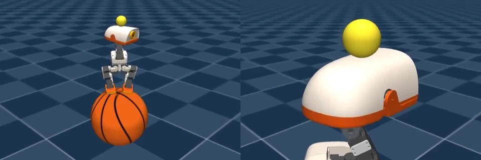

<h1 align="center">Microduck Double Balance</h1>

<p align="center">Balancing on a basketball, with a second ball on the head.</p>

<p align="center">
  <strong>English</strong> · <a href="README.zh-CN.md">简体中文</a>
</p>

<p align="center">
  <a href="experiments/double-balance/README.md">Demonstrations</a> ·
  <a href="docs/double-balance/README.md">Documentation</a> ·
  <a href="docs/double-balance/model-card.md">Model</a> ·
  <a href="#getting-started">Get started</a>
</p>

<p align="center">
  <a href="https://raw.githubusercontent.com/liuxue-lab/microduck-double-balance/refs/heads/double-balance/experiments/double-balance/media/balance.mp4">
    
  </a>
</p>

<p align="center"><sub>12-second preview · <a href="https://raw.githubusercontent.com/liuxue-lab/microduck-double-balance/refs/heads/double-balance/experiments/double-balance/media/balance.mp4">Download 1440p MP4 · 60 s · 50 fps</a></sub></p>

<p align="center"><strong>50 Hz control</strong> &nbsp;·&nbsp; <strong>200 Hz physics</strong> &nbsp;·&nbsp; <strong>6,000 measured control cycles</strong></p>

[](https://github.com/liuxue-lab/microduck-double-balance/actions/workflows/ci.yml?query=branch%3Adouble-balance)
[](LICENSE)

Microduck Double Balance brings together **PPO training, recurrent whole-body control and Jetson deployment**.
The robot balances on a free-rolling basketball while keeping a second ball directly on its original head shell.
In the hardware-in-the-loop system, native MuJoCo runs the robot and ball dynamics on a PC;
a Jetson Orin Nano Super computes the actions over wired ROS2 Humble.

## Highlights

- **Two coupled balance objectives.** A learned policy coordinates 14 joints to control the lower support and upper ball together.
- **A complete training-to-deployment path.** The recurrent actor runs as FP32 ONNX on the Jetson, with its observation normalization and recurrent state intact.
- **Measured real-time execution.** Two 60-second cases completed with zero missed 20 ms deadlines, including communication, physics and action checks.
- **Live visualization and inspectable data.** An independent 3D viewer accompanies the control loop; reports, model identities and media provenance are documented.

## Demonstrations

The experiment explores steady balancing and recovery from repeated horizontal disturbances.

**[Watch both demonstrations →](experiments/double-balance/README.md)**

## Performance

Complete-cycle timing from the two 60-second runs with the live viewer enabled:

| Scenario | Mean | p99 | Maximum | Missed deadlines |
| --- | ---: | ---: | ---: | ---: |
| Balance | 10.888 ms | 13.279 ms | 15.310 ms | 0 / 3,000 |
| Disturbance recovery | 11.317 ms | 12.634 ms | 14.676 ms | 0 / 3,000 |

The disturbance case applies horizontal force pulses equal to 10% of body weight.
Both runs retained the two balls for the full 60 seconds.
[Experiment details](experiments/double-balance/README.md#evaluation) ·
[Timing data](docs/double-balance/evidence/reports/live-control-report.json)

## Getting started

Clone the active branch and install the locked environment with `uv`:

```bash
git clone --branch double-balance git@github.com:liuxue-lab/microduck-double-balance.git
cd microduck-double-balance
uv sync --frozen
uv run --frozen python -m pytest tests/ -q
```

This runs the project's CPU test suite. For the PC–Jetson setup, see the
[setup guide](docs/double-balance/getting-started.md) and
[model card](docs/double-balance/model-card.md), including the required external model assets.

## Explore the project

| Start here | What you will find |
| --- | --- |
| [Demonstrations](experiments/double-balance/README.md) | Balance, disturbance recovery and evaluation settings |
| [Documentation](docs/double-balance/README.md) | System design, model, implementation and reproduction |
| [Code guide](docs/double-balance/code-guide.md) | Training tasks, control loop, inference and visualization |
| [Experiment collection](experiments/README.md) | Double balance and the original Playground experiments |
| [Contributing](CONTRIBUTING.md) | Development workflow and checks |

## Future direction

How can trajectory tracking be integrated with whole-body control so that Microduck follows a desired path while balancing on a basketball and keeping a second ball on its head?

## Upstream and contributions

Built on Hannes von Essen / Vottivott's [Microduck Playground](https://github.com/Vottivott/microduck-playground),
[Pollen Robotics' Microduck RL](https://github.com/pollen-robotics/microduck_rl),
[mjlab](https://github.com/mujocolab/mjlab) and [BAM](https://github.com/Rhoban/bam).
See the [upstream overview](docs/upstream/README.md) for the original experiments and hardware designs.

## License

Software is licensed under [Apache-2.0](LICENSE); inherited hardware designs follow
[CC BY-NC-SA 4.0](LICENSE-HARDWARE). Attribution and citation: [NOTICE](NOTICE) · [CITATION.cff](CITATION.cff).
