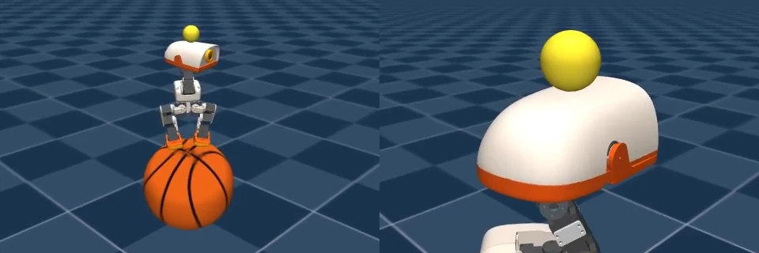
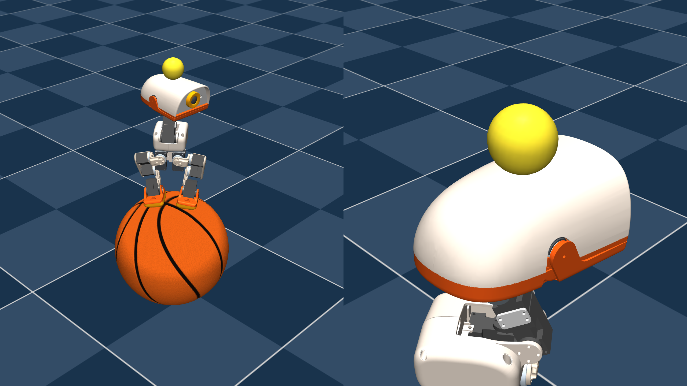
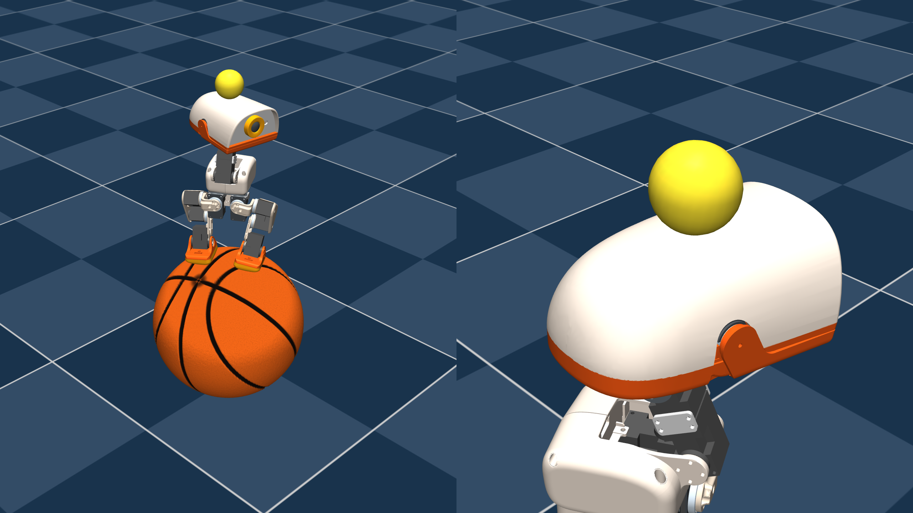

# 双球平衡

[项目首页](../../README.zh-CN.md) · [English](README.md) · **简体中文**

循环策略协调 Microduck 的 14 个关节，使机器人站在篮球上，同时保持直接接触原头壳的上方小球平衡。
PC–Jetson 硬件在环系统结合原生 MuJoCo 动力学与 Jetson Orin Nano Super 上的 FP32 ONNX 推理。

## 自然平衡

12 秒预览 · [下载高清 MP4 · 1440p · 60 秒 · 50 fps](https://raw.githubusercontent.com/liuxue-lab/microduck-double-balance/refs/heads/double-balance/experiments/double-balance/media/balance.mp4)

下方篮球自由滚动，机器人通过全身协调维持自身与头顶小球的平衡。

## 抗扰恢复

12 秒预览 · [下载高清 MP4 · 1440p · 60 秒 · 50 fps](https://raw.githubusercontent.com/liuxue-lab/microduck-double-balance/refs/heads/double-balance/experiments/double-balance/media/disturbance-recovery.mp4)

重复水平力脉冲改变机器人与支撑的运动状态，考察策略的平衡恢复能力。
每次扰动力相当于机器人自重的 10%。

[媒体说明](media/README.zh-CN.md) · [模型说明](../../docs/double-balance/model-card.md)

## 高清画面

| 自然平衡 · 10 秒 | 抗扰恢复 · 10 秒 |
| --- | --- |
|  |  |

点击图片查看完整 2560 × 1440 PNG 原图。

## 实验设置

开启实时三维窗口后，分别运行两组 60 秒测试，控制周期为 20 ms。
完整周期计时覆盖通信、参考动作对照、物理计算及状态发布。

| 工况 | 周期数 | 均值 | p95 | p99 | 最大值 | 超时周期 |
| --- | ---: | ---: | ---: | ---: | ---: | ---: |
| 自然平衡 | 3,000 | 10.888 ms | 12.380 ms | 13.279 ms | 15.310 ms | 0 |
| 抗扰恢复 | 3,000 | 11.317 ms | 12.214 ms | 12.634 ms | 14.676 ms | 0 |

两组均完成整个回合的双球保持。任务允许机器人和下方篮球在保持平衡的同时发生平移。

自然平衡对应报告中的 `quiet-2407`。抗扰恢复对应 `regression-2500`：
从第 2 秒到第 58 秒，每隔 2 秒向躯干质心施加一次随机方向的水平力，共 29 次；
每次持续 0.1 秒，标称力为 0.728590 N。

录像及其预览展示所记录的 HIL 轨迹，表格采用另一次开启实时窗口的测试数据。
媒体与测试记录的对应关系见[媒体说明](media/README.zh-CN.md)。

[原始测试报告](../../docs/double-balance/evidence/reports/live-control-report.json) ·
[详细技术报告](../../docs/double-balance/project-report.md) ·
[数据索引](../../docs/double-balance/evidence/README.md)

## 系统组成

| 环节 | 实现 |
| --- | --- |
| 物理 | PC CPU 原生 MuJoCo，200 Hz；每个控制周期包含 4 个物理子步 |
| 控制 | 有线 ROS2 Humble，50 Hz |
| 策略 | 循环 PPO actor，61 维观测、14 维动作 |
| 部署 | Jetson Orin Nano Super，FP32 ONNX，ONNX Runtime CPUExecutionProvider |
| 动作对照 | 每个实际应用的 Jetson 动作均与冻结 PyTorch actor 比较 |
| 显示 | 独立三维窗口，约 25 fps |

策略保留观测归一化、循环状态和既定 BAM 执行器合同，最终检查点累计完成 11,314 次训练更新。
[模型身份与部署资产](../../docs/double-balance/model-card.md)

## 阅读实现

- [代码导览](../../docs/double-balance/code-guide.zh-CN.md)：训练任务、物理、通信与显示。
- [开始使用](../../docs/double-balance/getting-started.zh-CN.md)：源码安装和运行前提。
- [复现说明](../../docs/double-balance/reproduction-guide.md)：既有 PC–Jetson 环境的运行入口。
- [项目文档](../../docs/double-balance/README.zh-CN.md)：结果、模型与技术资料。

## 后续研究方向

如何将轨迹跟踪与全身控制相结合，使 Microduck 在脚踩篮球、头顶小球的双重平衡约束下沿给定路径运动？

任务基于 [Microduck Playground 篮球实验](../basketball/README.md)扩展。
[来源与贡献](../../README.md#upstream-and-contributions) · [许可证](../../README.md#license)
